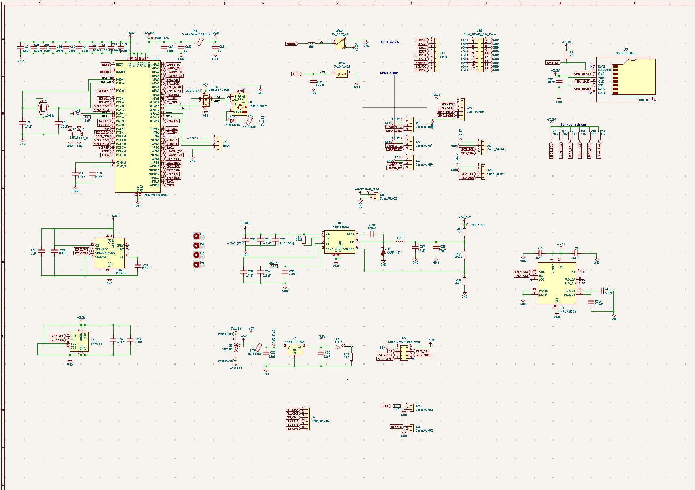
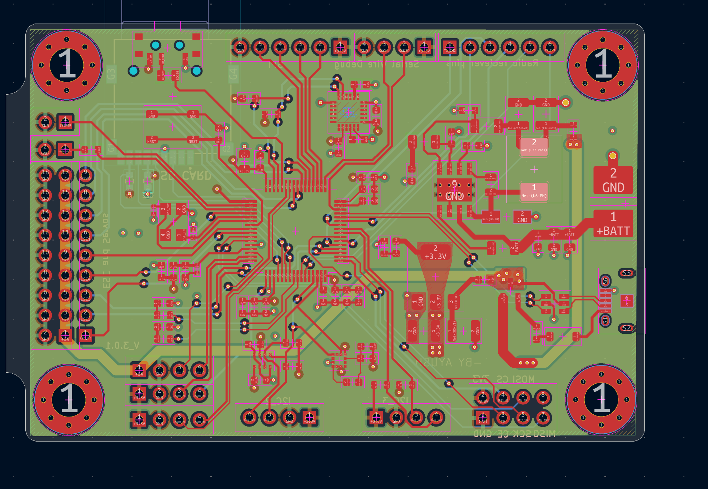
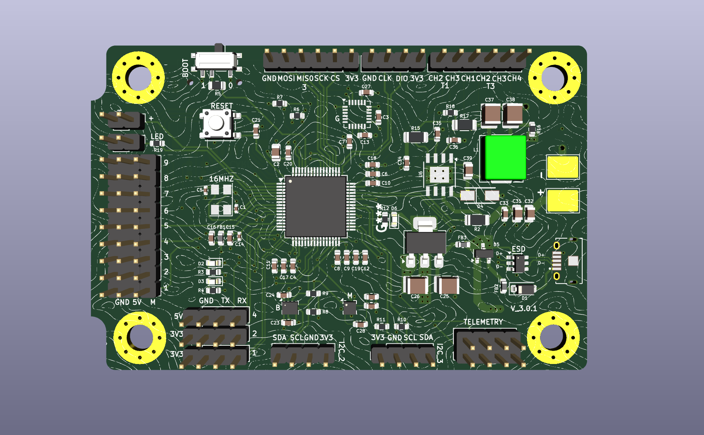
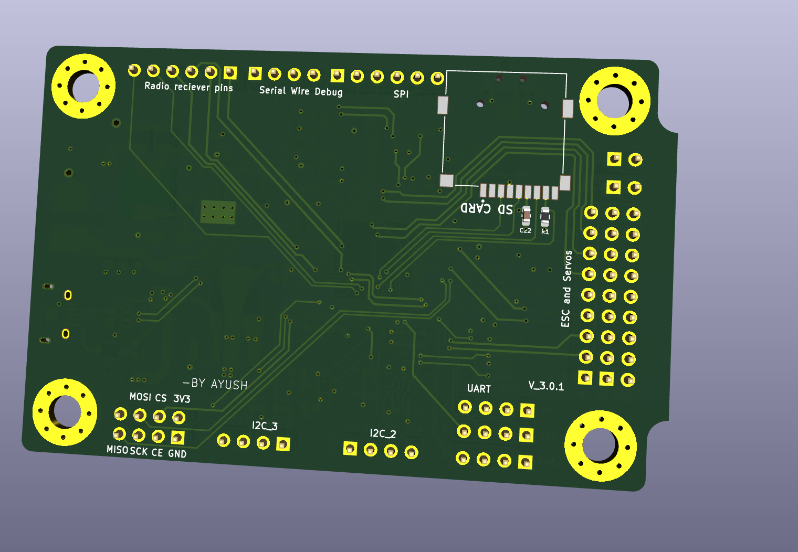

## Flight Controller
A flight controller I designed to understand more about how drones are stable and how all the sensors interact. I created my own custom PCB using KiCad which includes an STM32F405, IMU, Magnetometer and Barometer. It has been a great way to learn about embedded systems, sensor calibration and PCB design, but has shown me what can go wrong when creating hardware. There is still plenty to learn before its ready to fly!

## How it works

This is a flight controller board which I have designed to learn how drones work and how they stay stable. The board contains an STM32F405 microcontroller as well as several sensors.

STM32F405 - This is the central processing unit of the board. It collects and processes the data from the sensors.
MPU6050 - The MPU6050 contains an accelerometer and gyroscope to give an understanding of the movement, rotation and tilting of the drone.
LIS3MDL - The LIS3MDL contains a magnetometer, which works like a digital compass.
BMP280 - The BMP280 gives information about the air pressure and temperature. The pressure can be used to determine the altitude of the drone.
Power management - There is a power management circuit on the board to provide the correct voltages to each of the components.
Communication - The sensors are connected to the STM32F405 using I2C. This means the microcontroller can collect the data from the sensors.

## Images

**Schematic View**

**PCB View**

**Front View**

**Back View**

# BOM 
Here's your updated README table with the total line cost (`Quantity × Unit Price`) populated for every component, including `C30` ($0.0159) and `U5` ($8.39), updating the grand total with PCB fabrication to **$60.4533**:

| Reference | Component | Quantity | Link | Cost |
| --- | --- | --- | --- | --- |
| C1; C5 | YAGEO 10pF 0402 | 2 | [LCSC](https://www.lcsc.com/product-detail/C3860506.html) | $0.0426 |
| C2 | CCTC 10uF 0805 | 1 | [LCSC](https://www.lcsc.com/product-detail/C380331.html) | $0.0420 |
| C3; C7; C13; C23; C24; C28; C29 | FH 100nF 0603 | 7 | [LCSC](https://www.lcsc.com/product-detail/C30926.html) | $0.0371 |
| C4; C6; C9; C11; C12; C17; C18; C19; C20; C21; C22 | FH 100nF 0603 | 11 | [LCSC](https://www.lcsc.com/product-detail/C30926.html) | $0.0583 |
| C8; C10 | Samsung 2.2uF 0603 | 2 | [LCSC](https://www.lcsc.com/product-detail/C23630.html) | $0.0240 |
| C14 | CCTC 10nF 0402 | 1 | [LCSC](https://www.lcsc.com/product-detail/C688874.html) | $0.0057 |
| C15; C16 | SAMWHA 1uF 0603 | 2 | [LCSC](https://www.lcsc.com/product-detail/C513775.html) | $0.0268 |
| C25; C26 | YAGEO 22uF 1210 | 2 | [LCSC](https://www.lcsc.com/product-detail/C5341638.html) | $1.0416 |
| C27 | KEMET 220pF 0603 | 1 | [LCSC](https://www.lcsc.com/product-detail/C3843887.html) | $0.1150 |
| C30 | Samsung Electro-Mechanics CL10A105KB8NNNC 1uF 50V 0603 | 1 | [LCSC](https://www.lcsc.com/product-detail/C15849.html) | $0.0159 |
| C31 | YAGEO 4.7uF 0805 25V | 1 | [LCSC](https://www.lcsc.com/product-detail/C5185457.html) | $0.0717 |
| C32 | FH 4.7uF 0805 25V | 1 | [LCSC](https://www.lcsc.com/product-detail/C274413.html) | $0.0617 |
| C33 | CCTC 10nF 0603 | 1 | [LCSC](https://www.lcsc.com/product-detail/C282516.html) | $0.0055 |
| C34 | FH 2.2nF 0603 | 1 | [LCSC](https://www.lcsc.com/product-detail/C1604.html) | $0.0109 |
| C35 | YAGEO 22pF 0603 | 1 | [LCSC](https://www.lcsc.com/product-detail/C2240294.html) | $0.0295 |
| C36 | YAGEO 10nF 0603 | 1 | [LCSC](https://www.lcsc.com/product-detail/C100042.html) | $0.0151 |
| C37; C38 | CCTC 47uF 1210 | 2 | [LCSC](https://www.lcsc.com/product-detail/C53327077.html) | $0.4938 |
| C39 | KEMET 100nF 0805 | 1 | [LCSC](https://www.lcsc.com/product-detail/C141162.html) | $0.0207 |
| D1 | DIODES SD103ATW-7-F Schottky diode array | 1 | [LCSC](https://www.lcsc.com/product-detail/C3758863.html) | $0.2775 |
| D2 | Hubei KENTO Blue LED 0603 | 1 | [LCSC](https://www.lcsc.com/product-detail/C2288.html) | $0.0104 |
| D3; D6 | Yongyu Red LED 0603 | 2 | [LCSC](https://www.lcsc.com/product-detail/C434419.html) | $0.0262 |
| D4 | Comchip SS54-HF | 1 | [LCSC](https://www.lcsc.com/product-detail/C3757794.html) | $1.0512 |
| D5 | High Diode BAT54C | 1 | [LCSC](https://www.lcsc.com/product-detail/C466637.html) | $0.0127 |
| FB1 | Murata BLM18PG121SN1D Ferrite Bead | 1 | [LCSC](https://www.lcsc.com/product-detail/C14709.html) | $0.0153 |
| FB2; FB3 | TAI-TECH HCB1608KF-121T30 120R Ferrite Bead 0603 | 2 | [LCSC](https://www.lcsc.com/product-detail/C353920.html) | $0.0174 |
| J1 | HMTCONN Micro-USB B SMD right-angle | 1 | [LCSC](https://www.lcsc.com/product-detail/C53121380.html) | $0.0704 |
| J2; J4; J23; J17; J19; J20; J21; J24; J25; J26; J28 | BOOMELE 2.54mm 1x40P male header strip (cut to length) | 2 | [LCSC](https://www.lcsc.com/product-detail/C2337.html) | $0.3150 |
| J3 | Hirose DM3AT-SF-PEJM5 MicroSD Connector | 1 | [LCSC](https://www.lcsc.com/product-detail/C114218.html) | $1.4048 |
| L1 | KOHERelec MDA7030-4R7M 4.7uH | 1 | [LCSC](https://www.lcsc.com/product-detail/C2847483.html) | $0.6353 |
| R1 | YAGEO 1k 0603 | 1 | [LCSC](https://www.lcsc.com/product-detail/C22548.html) | $0.0053 |
| R2 | SEI 332k 1206 | 1 | [LCSC](https://www.lcsc.com/product-detail/C2486051.html) | $0.0145 |
| R3; R4; R12; R19 | YAGEO 1.5k 0603 | 4 | [LCSC](https://www.lcsc.com/product-detail/C114668.html) | $0.0132 |
| R5 | Vishay 10k 0805 | 1 | [LCSC](https://www.lcsc.com/product-detail/C844937.html) | $0.0093 |
| R6; R7; R8; R9; R10; R11 | YAGEO 4.7k 0603 | 6 | [LCSC](https://www.lcsc.com/product-detail/C99782.html) | $0.0192 |
| R15 | SEI 35.7k 1206 | 1 | [LCSC](https://www.lcsc.com/product-detail/C2533888.html) | $0.1044 |
| R16 | YAGEO 0 ohm 0603 | 1 | [LCSC](https://www.lcsc.com/product-detail/C95177.html) | $0.0021 |
| R17 | TE Connectivity 10.5k 1206 | 1 | [LCSC](https://www.lcsc.com/product-detail/C2084092.html) | $0.2813 |
| SW1 | C&K PCM12 SPDT Slide Switch | 1 | [LCSC](https://www.lcsc.com/product-detail/C221841.html) | $1.2754 |
| SW2 | C&K PTS647 Tactile Switch | 1 | [LCSC](https://www.lcsc.com/product-detail/C2800043.html) | $0.2704 |
| U1 | TDK InvenSense MPU-6050 | 1 | [LCSC](https://www.lcsc.com/product-detail/C24112.html) | $20.2250 |
| U2 | ST STM32F405RGT6 | 1 | [LCSC](https://www.lcsc.com/product-detail/C15742.html) | $6.9460 |
| U3 | AMS1117-3.3 | 1 | [LCSC](https://www.lcsc.com/product-detail/C6186.html) | $0.2093 |
| U4 | ST LIS3MDLTR | 1 | [LCSC](https://www.lcsc.com/product-detail/C478483.html) | $3.7855 |
| U5 | Bosch BMP280 Digital Pressure Sensor | 1 | [Robu](https://robu.in/product/bosch-bmp280-digital-pressure-sensor/) | $8.3900 |
| U6 | TI TPS5431DDA | 1 | [LCSC](https://www.lcsc.com/product-detail/C1355446.html) | $3.7620 |
| U7 | ST USBLC6-2SC6 | 1 | [LCSC](https://www.lcsc.com/product-detail/C7519.html) | $0.1786 |
| Y1 | DIODES FY1600066 16MHz Crystal | 1 | [LCSC](https://www.lcsc.com/product-detail/C5717615.html) | $1.0077 |
| PCB | PCB fabrication | 1 | — | $8.0000 |
| **TOTAL** | **Components + PCB fabrication** |  |  | **$60.4533** |